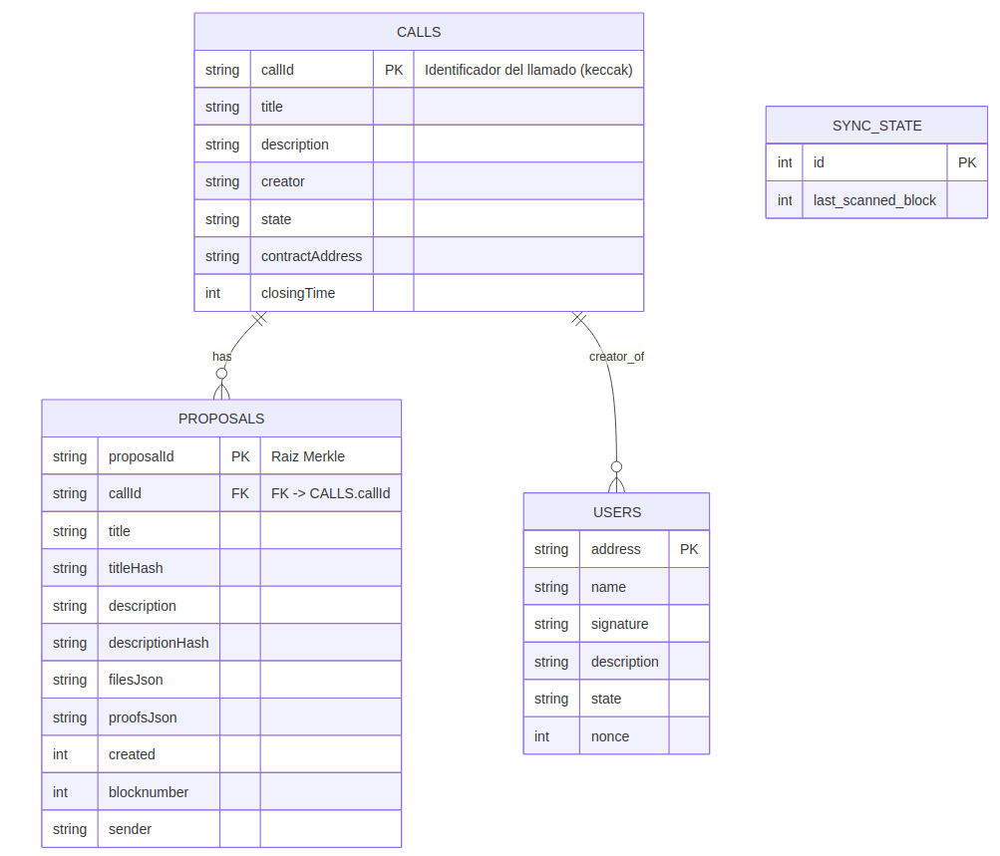

# API TP10 (ETAPA 1 y 2)

Este directorio contiene la implementación de la API REST que interactúa con los contratos `CFP` y `CFPFactory`, además de la persistencia off-chain necesaria para la etapa 1.

# Resumen de cambios principales 
## ETAPA 1

* **Migración del esquema de firma:** Se actualizó la lógica de firma de EIP-191 a EIP-712. Los tests y funciones auxiliares fueron adaptados para utilizar `eth_account.messages.encode_structured_data` y tipos EIP-712. Esto minimiza las modificaciones en las pruebas debido a que las funciones ayudantes (*helpers*) conservan sus nombres y parámetros originales.
* **Nuevos endpoints añadidos / expuestos para la interfaz de administración:** `GET /admin/address`, `GET /creators`, `GET /users`, `GET /users/pending`.
* **Eliminado el estado "ARCHIVED":** El estado archived fue descartado en esta etapa del tp.
### Detalles de la migración de firmas

* **Esquema anterior:** Firmas EIP-191 (mensajes con prefijos y utilización de `encode_defunct`).
* **Esquema actual:** Firmas EIP-712 (mensajes estructurados). Se definieron las estructuras en `EIP712_TYPES`, un dominio dinámico mediante `get_eip712_domain` y se reescribieron las funciones `make_*_message(...)` para devolver diccionarios estructurados listos para ser firmados.

### Impacto en tests

El archivo `test_apiserver.py` se actualizó para incorporar `encode_structured_data` junto con las nuevas funciones de generación y firmado. La mayor parte del cuerpo de las pruebas originales no requirió modificaciones adicionales.

### Endpoints añadidos y modificados

* `POST /create`: Registra en la API un llamado en estado `pending` y requiere la firma EIP-712 del creador.
* `POST /register`: Registro de usuarios (sin cambios funcionales en el contrato, pero adaptado al estándar EIP-712).
* `GET /admin/address`: Devuelve la dirección administradora configurada en la interfaz.
* `GET /creators`: Lista los creadores conocidos por el sistema.
* `GET /users`: Lista los usuarios registrados en la base de datos.
* `GET /authorization-requests`: Lista los usuarios que se encuentran esperando la autorización por parte del administrador.

## Nuevos Casos de Prueba Añadidos (`test_apiserver.py`)

Se incorporó una serie de pruebas unitarias e de integración con el fin de validar el comportamiento de los nuevos endpoints expuestos y asegurar la robustez de las restricciones aplicadas a la cuenta del administrador:

### Validaciones de Endpoints e Integración de Creadores

* `test_get_admin_address_endpoint()`: Verifica que el endpoint retorne de manera correcta la dirección del administrador configurada en el entorno del servidor.
* `test_get_creators_integration()`: Valida que el listado completo de creadores integrados en el ecosistema sea recuperado sin inconsistencias.

### Registro y Actualización con Descripciones

* `test_update_registration_description(authorized_accounts)`: Evalúa la capacidad del sistema para actualizar la descripción asociada al registro de un usuario previamente autorizado.
* `test_register_with_description()`: Comprueba el flujo de registro inicial de un usuario que proporciona datos descriptivos adicionales.

### Gestión de Usuarios y Peticiones Administrativas

* `test_get_all_users()`: Garantiza que el endpoint retorne de forma fidedigna la lista global de usuarios registrados.
* `test_get_authorization_requests()`: Inspecciona el correcto filtrado y devolución de aquellos usuarios cuyas peticiones de acceso se encuentran en estado pendiente de aprobación.

### Restricciones Críticas sobre la Dirección del Administrador

* `test_admin_cannot_register_admin_address()`: Asegura que el sistema bloquee cualquier intento de registro de la propia dirección del administrador como usuario convencional.
* `test_admin_cannot_authorize_admin_address()`: Valida la imposibilidad de ejecutar autorizaciones orientadas a la dirección del administrador.
* `test_admin_cannot_unauthorize_admin_address()`: Confirma que no se puedan remover privilegios ni modificar estados de autorización sobre la cuenta raíz administrativa.
* `test_admin_cannot_update_registration_for_admin_address()`: Verifica el rechazo de solicitudes destinadas a alterar los datos de registro vinculados a la dirección del administrador.

## ETAPA 2

## Endpoints añadidos

 * `GET /calls-by/address`: Devuelve dos listas: solicitudes externas (solo blockchain) y solicitudes locales (usuarios en estado pending o registered en la API).
 * `GET /calls-by/address`: Devuelve dos listas: solicitudes externas (solo blockchain) y solicitudes locales (usuarios en estado pending o registered en la API).
## Nuevos Casos de Prueba Añadidos (`test_apiserver.py`)
* `def test_get_global_calls_catalog_structure()`: Prueba que el endpoint unificado GET /calls devuelva correctamente la estructura del catálogo global, segmentando convocatorias internas y externas.
* `def test_get_calls_by_address_structure()`: Prueba que el endpoint GET /calls/{address} devuelva la estructura de listas esperada.
* `def test_admin_cannot_execute_create_endpoint()`: Prueba que un administrador no tenga permitido ejecutar el endpoint /create, retornando un código de error 400 (Bad Request) con el mensaje de dirección inválida.
---

## Variables de entorno requeridas

La API utiliza variables de entorno para su configuración (véase `.env.example`). Las principales variables necesarias son:

* `WEB3_PROVIDER_URL`: URL RPC del nodo de desarrollo (por defecto `http://127.0.0.1:8545`).
* `CFP_FACTORY_ADDRESS`: Dirección del contrato `CFPFactory` desplegado en la red.
* `CFP_MNEMONIC`: Frase mnemónica utilizada para derivar la cuenta del Owner del contrato.
* `DERIVACION_PATH`: Ruta de derivación criptográfica (por defecto `m/44'/60'/0'/0/0`).
* `CFP_DB_PATH`: Ruta al archivo SQLite utilizado por la API (por ejemplo, `db/database.db`).
* `CFP_ADMIN_ADDRESS`: Dirección administradora configurada en la aplicación.

Se incluye un archivo `.env.example` en este directorio que expone la estructura y los valores de ejemplo. Para entornos de desarrollo, se debe copiar `.env.example` a `.env` y ajustar las variables correspondientes.

---

## Requisitos de Ejecución

* Un nodo local compatible con Hardhat debe encontrarse en ejecución en la dirección especificada por `WEB3_PROVIDER_URL` (por ejemplo, mediante `npx hardhat node`). La API requiere conectarse activamente al RPC para la lectura de eventos y el envío de transacciones.
* Ejecución del servidor ASGI mediante Uvicorn:
```bash
uvicorn api:app --reload --port 5000

```


* Ejecución de la suite de pruebas del servidor:
```bash
CFP_MNEMONIC="<mnemonic>" CFP_FACTORY_ADDRESS="<factory>" CFP_ADMIN_ADDRESS="<admin>" pytest test_apiserver.py

```


Los tests requieren estrictamente que las variables de entorno `CFP_MNEMONIC`, `CFP_FACTORY_ADDRESS` y `CFP_ADMIN_ADDRESS` se encuentren cargadas en la terminal de ejecución. Estas direcciones deben derivar de la misma frase mnemonica

---

## Base de datos (persistencia)

La API usa SQLite a través de modelos `SQLModel`. Las tablas principales mapeadas e indexadas en el sistema son `calls`, `proposals`, `users` y `sync_state`.

### Esquema de la base de datos

El diseño del modelo entidad-relación correspondiente a la persistencia *off-chain* se detalla a continuación mediante el diagrama adjunto en el repositorio:


### Notas sobre el diagrama

* La entidad `PROPOSALS` mantiene una relación de clave foránea mediante el campo `callId` hacia la tabla de llamados (`CALLS`).
* El campo `address` actúa como clave primaria en la entidad `USERS`, la cual almacena los estados correspondientes a los flujos de registro, autorización y validación del `nonce`.


## Estructura de directorios (resumen)

```text
api/
├─ api.py
├─ test_apiserver.py
├─ requirements.txt
├─ .env.example
├─ db_diagram.png
├─ db/
│  └─ sqliteManager.py
├─ models/
│  ├─ persistence/
│  │  ├─ Call.py
│  │  ├─ Proposal.py
│  │  ├─ SyncState.py
│  │  └─ User.py
├─ requests/
├─ services/
│  ├─ contractManager.py
│  └─ signer.py
└─ test/

```

### Archivos de pruebas y migración de firma

El archivo `test_apiserver.py` fue adaptado para el estándar EIP-712. Las modificaciones clave incluyen: el reemplazo de `encode_defunct` por `encode_structured_data`, la eliminación de prefijos binarios manuales, la definición estructurada de `EIP712_TYPES`, la integración de las funciones `get_eip712_domain(...)` y `make_*_message(...)`, junto con la actualización de `sign_bytes(...)` para procesar diccionarios estructurados.

### Referencias internas

* **ABIs de los contratos:** Ubicados en `services/cfp_abi.json` y `services/cfp_factory_abi.json`.
* **Configuraciones del sistema:** Gestionadas a través de `services/settings.py`.