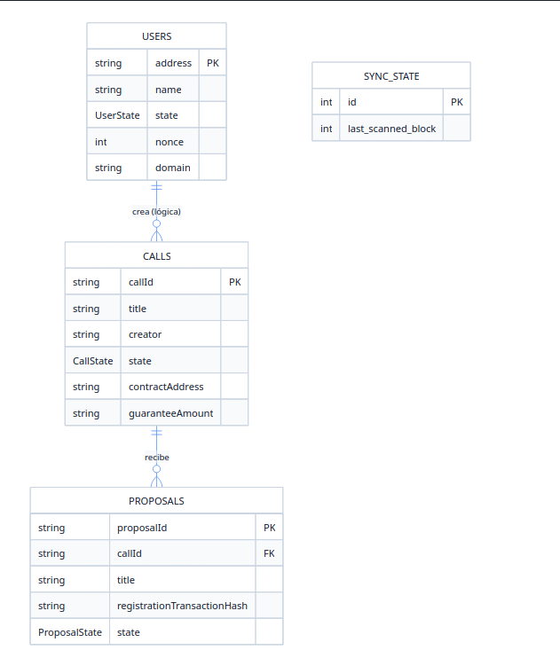

# API

## Árbol del Proyecto

A continuación se detalla la estructura jerárquica de archivos y directorios del proyecto.

```text
api/
├── api.py # codigo principal
├── db
│   └── DBManager.py           # Operaciones en base de datos
│
├── exceptions                 # Excepciones personalizadas
│
├── listeners
│   └── BlockChainWorker.py    # Listener de eventos en blockchain
├── messages.py                # Mensajes para respuestas
├── models                     # Entidades de BD y clases DTO 
│   ├── AuthorizeAddress.py     
│   ├── CallCreate.py
│   ├── persistence
│   ├── ProposalRegister.py
│   ├── UnauthorizeAddress.py
│   ├── UserPatch.py
│   ├── UserRegister.py
│   ├── VerifyProof.py
│   └── VerifyReceipt.py
├── services                   # Servicios utilitarios para API
│   ├── BlockchainConector.py
│   ├── cfp_abi.json
│   ├── cfp_factory_abi.json
│   ├── CFPManager.py
│   ├── ENSManager.py
│   ├── registry_abi.json
│   ├── resolver_abi.json
│   ├── settings.py
│   └── signer.py
└── uploaded_files
```

---

## Despliegue

### Requisitos Previos
* **Entorno de ejecución:** Es necesario contar con una instancia local de la red Hardhat en ejecución, sobre la cual deben haberse desplegado previamente los smart contracts del ecosistema CFP (disponibles en el directorio /contracts).

### Variables de Entorno
Crear un archivo `.env` en la raíz del proyecto basándose en `.env.example` con los siguientes parámetros:
| Variable | Descripción | Valor ejemplo |
| --- | --- | --- |
| `WEB3_PROVIDER_URL` | URL del nodo de la Blockchain (Ganache, Infura, Alchemy, etc.) | `[http://127.0.0.1:8545](http://127.0.0.1:8545)` |
| `CFP_FACTORY_ADDRESS` | Dirección del contrato `CFPFactory` desplegado en la red | `0x112fd8b95AC6011BA4927F4420f55d7a0d517c7F` |
| `CFP_MNEMONIC` | Mnemónico de 12 palabras de la billetera de desarrollo | `cram play gadget current hint foster photo copy space panel junk nuclear` |
| `DERIVACION_PATH` | Ruta de derivación estándar de Ethereum para HD Wallets | `m/44'/60'/0'/0/0` |
| `CFP_DB_PATH` | Ruta local donde se creará y guardará la base de datos SQLite | `db/database.db` |
| `CFP_ADMIN_ADDRESS` | Dirección del administrador del sistema | `0x1c20ed4C1464c1ffb9Fd04d94779E3Da7FbefeF6` |
| `PROPOSALS_UPLOAD_DIR` | Directorio local donde se almacenarán los archivos subidos mediante la API | `uploaded_files` |
| `ENS_REGISTRY_ADDRESS` | Dirección del contrato ENS Registry desplegado en la red | `0x5FbDB2315678afecb367f032d93F642f64180aa3` |
| `ENS_RESOLVER_ADDRESS` | Dirección del contrato ENS Resolver desplegado en la red | `0xe7f1725E7734CE288F8367e1Bb143E90bb3F0512` |
| `TOKEN_ADDRESS` | Dirección del token ERC-20 desplegado en la red (para la garantía) | `0x959922bE3CAee4b8Cd9a407cc3ac1C251C2007B1` |

Las direcciones y frases Mnemónicas podran sacarse del script de deploy de contratos (Ver carpeta /contracts)

### Pasos para la Ejecución en Entorno Local

1. **Instalar dependecias del requirement.txt**

2. **Ejecutar api con uvicorn:**
   ```bash
   uvicorn api:app --port 50000
   ```
A partir de este momento comenzara a ejecutarse la api.

---

## 3. Endpoints

### Detalle de Endpoints
A continuación se presenta la documentación exhaustiva de los endpoints expuestos por la API, detallando su propósito, la estructura esperada en las peticiones (cuerpo) y los códigos de respuesta correspondientes.

---

### 1. Convocatorias (Calls)

### `POST /create`

Registra un llamado a presentación de propuestas de manera local y verifica su correspondencia con la blockchain.

* **Cuerpo Esperado (`CallCreate`)**:
* `callId`: Identificador único generado mediante hash Keccak256 (32 bytes en formato hexadecimal con prefijo 0x).


* `title`: Título del llamado, con una longitud máxima de 512 bytes en codificación UTF-8.


* `description`: Descripción del llamado, con una longitud máxima permitida de 4096 bytes en codificación UTF-8.


* `signature`: Firma criptográfica de 65 bytes generada por el creador en formato hexadecimal.


* `domain`: Nombre de dominio del servicio ENS asociado al usuario.


* `guaranteeAmount`: Valor de la garantía requerida en formato de texto expresada en unidades mínimas (Wei) del token ERC-20.


* **Códigos de Respuesta**:
* **201**: La convocatoria ha sido registrada exitosamente.


* **400**: Solicitud incorrecta (dominio inválido, firma inválida o dirección de administrador no permitida).


* **403**: Acción prohibida (la convocatoria ya existe o el emisor no está autorizado).


* **500**: Error interno del servidor o de conexión con la blockchain/base de datos.


### `GET /calls/{call_id}`

Obtiene la información de un llamado registrado localmente.

* **Parámetros**: `call_id` (Hash identificador del llamado).


* **Códigos de Respuesta**:
* **200**: Retorna la información del llamado incluyendo estado, creador, descripción, etc.


* **400**: El identificador provisto no cumple con el formato hexadecimal esperado.


* **404**: El llamado no se encuentra registrado.


* **500**: Error de conexión con la base de datos o estado inesperado.


### `GET /closing-time/{call_id}`

Obtiene la fecha y hora de cierre de un llamado.

* **Parámetros**: `call_id` (Hash identificador del llamado).


* **Códigos de Respuesta**:
* **200**: Retorna la propiedad `closingTime` en formato ISO 8601.


* **400**: Formato de identificador inválido.


* **404**: Llamado no encontrado.


* **500**: Error de lectura en la base de datos o infraestructura blockchain.


### `GET /calls-by/{address}`

Obtiene las convocatorias creadas por una dirección específica.

* **Parámetros**: `address` (Dirección Ethereum del creador).


* **Códigos de Respuesta**:
* **200**: Retorna listas de convocatorias locales y externas asociadas a la dirección.


* **400**: Dirección inválida o correspondiente al administrador.


* **500 / 502**: Fallo de base de datos o error de pasarela blockchain.


### `GET /global-calls`

Obtiene la totalidad de las convocatorias globales registradas en la blockchain, clasificándolas en internas y externas respecto a la base local.

* **Códigos de Respuesta**:
* **200**: Retorna objetos separados para llamadas `internal` y `external`.


* **500 / 502**: Error interno o fallo de comunicación con la red.


### `GET /calls/{call_id}/contract`

Obtiene la dirección del contrato inteligente desplegado para un llamado.

* **Parámetros**: `call_id` (Hash identificador del llamado).


* **Códigos de Respuesta**:
* **200**: Retorna la dirección del contrato en la red.


* **400**: Formato de identificador inválido.


* **404**: Llamado no encontrado o dirección no generada.


* **500**: Error al consultar recursos locales o blockchain.


### 2. Usuarios y Autorizaciones

### `POST /register`

Registra un usuario en el sistema asociando su dirección con un nombre y dominio de forma local.

* **Cuerpo Esperado (`UserRegister`)**:
* `address`: Dirección de Ethereum de 20 bytes en formato hexadecimal.


* `name`: Nombre del solicitante, máximo 512 bytes.


* `signature`: Firma criptográfica del solicitante de 65 bytes.


* `description`: Descripción opcional del usuario creador.


* `domain`: Nombre de dominio ENS verificado.


* **Códigos de Respuesta**:
* **200**: Registro procesado con éxito, retorna el estado actual del usuario.


* **400**: Dirección inválida, firma incorrecta o dominio que no resuelve correctamente.


* **403**: La cuenta ya fue registrada y posee un estado activo distinto a pendiente.


* **500**: Error de servidor.


### `GET /registrations/{address}`

Obtiene el estado de registro de una dirección en el sistema.

* **Parámetros**: `address` (Dirección Ethereum).


* **Códigos de Respuesta**:
* **200**: Retorna el estado del usuario, nombre, descripción, nonce y dominio (o estado pendiente si no se encuentra).


* **400**: Formato de dirección inválido.


* **500**: Fallo interno.


### `PATCH /registrations/{address}`

Actualiza el nombre y la descripción asociados a una dirección, incrementando su nonce.

* **Parámetros**: `address` (Dirección Ethereum).


* **Cuerpo Esperado (`UserPatch`)**:
* `name`: Nuevo nombre del solicitante.


* `signature`: Firma criptográfica verificadora.


* `description`: Nueva descripción corta opcional.


* **Códigos de Respuesta**:
* **200**: Operación exitosa.


* **400**: Firma inválida, desbordamiento del nonce o dirección inválida.


* **404**: Usuario no registrado localmente.


* **500**: Error interno.


### `GET /authorized/{address}`

Verifica el estado de autorización de una dirección consultando la blockchain.

* **Parámetros**: `address` (Dirección Ethereum).


* **Códigos de Respuesta**:
* **200**: Retorna propiedad booleana `authorized`.


* **400**: Formato de dirección inválido.


* **500**: Error interno.


### `GET /users`

Obtiene la lista completa de usuarios registrados en la base de datos local y su estado.

* **Códigos de Respuesta**:
* **200**: Retorna matriz de usuarios y cantidad total.


* **500**: Error de base de datos o proceso.


### `GET /creators`

Lista las direcciones creadoras contrastando la blockchain con la base de datos local.

* **Códigos de Respuesta**:
* **200**: Retorna creadores registrados y externos.


* **500 / 502**: Error interno o de comunicación con blockchain.


### 3. Propuestas y Entregas Post-Cierre

### `POST /register-proposal`

Registra una propuesta de forma anónima vinculada a una convocatoria específica.

* **Cuerpo Esperado (`ProposalRegister`)**:
* `callId`: Identificador hexadecimal del llamado asociado.


* `title`: Título de la propuesta, máximo 512 bytes.


* `description`: Descripción de la propuesta, máximo 4096 bytes.


* `files`: Lista de strings con los hashes hexadecimales correspondientes a los archivos (máximo 125 elementos).


* `blockchain`: Valor booleano que indica si el registro debe propagarse a la blockchain.


* **Códigos de Respuesta**:
* **201**: Propuesta registrada, retorna identificador y pruebas de Merkle.


* **403**: Propuesta ya registrada previamente.


* **404**: Identificador de llamado no encontrado.


* **500**: Error interno, fallo de infraestructura o fondos insuficientes de gas.


### `GET /proposal-data/{call_id}/{proposal}`

Obtiene la información técnica y procedencia de una propuesta.

* **Parámetros**: `call_id` (Hash del llamado), `proposal` (Raíz de Merkle de la propuesta).


* **Códigos de Respuesta**:
* **200**: Retorna dirección emisora, bloque, marca de tiempo y estado.


* **400**: Formato inválido de `call_id` o `proposal`.


* **404**: Llamado o propuesta inexistente.


* **500**: Fallo interno.


### `GET /calls/{call_id}/proposals`

Lista públicamente todas las propuestas vinculadas a una convocatoria.

* **Parámetros**: `call_id` (Identificador de la convocatoria).


* **Códigos de Respuesta**:
* **200**: Lista de propuestas encontradas con título, descripción y estado.


* **500**: Error interno.


### `GET /proposals/{proposalId}/receipt`

Genera y entrega el recibo portable original de una propuesta.

* **Parámetros**: `proposalId` (Raíz de Merkle de la propuesta).


* **Códigos de Respuesta**:
* **200**: Retorna la estructura detallada del recibo (pruebas, hashes, transacción y remitente).


* **404**: Propuesta no encontrada.


* **500**: Fallo de lectura.


### `POST /proposals/verify-receipt`

Valida la integridad matemática de un recibo portable y verifica su existencia en la blockchain.

* **Cuerpo Esperado (`VerifyReceipt`)**:
* `callId`: Hash del llamado asociado.


* `proposalId`: Raíz de Merkle.


* `title`: Título de la propuesta.


* `description`: Descripción de la propuesta.


* `files`: Lista base de hashes declarados.


* `proofs`: Diccionario asociando hashes a sus pruebas de Merkle correspondientes.


* `fileHashesToVerify`: Lista opcional de hashes específicos a verificar contra el árbol.


* **Códigos de Respuesta**:
* **200**: Retorna objeto indicando el resultado de validación (`valid` y detalles).


* **400**: Fallo de validación criptográfica estructural.


* **500 / 502**: Fallo de proceso o de conexión al nodo RPC.


### `POST /proposals/submit-post-closing`

Recibe un recibo junto con archivos físicos, verifica su correspondencia íntegra y registra la entrega post-cierre en la blockchain.

* **Cuerpo Esperado (Form-Data)**:
* `receipt_data`: String JSON conteniendo la estructura del recibo.


* `uploaded_files`: Lista de objetos binarios/archivos enviados.


* **Códigos de Respuesta**:
* **200**: Operación de guardado y asentamiento blockchain finalizada con éxito.


* **400**: Hashes de archivos que no coinciden o adulteración detectada.


* **404**: Compromiso no encontrado en la blockchain.


* **422**: Formato JSON de recibo ilegible o mal estructurado.


* **500 / 502**: Fallo interno al guardar en disco o falla en transacción de red.


### `GET /proposals/{proposal_id}/reception-receipt`

Obtiene el recibo público definitivo de una propuesta, incluyendo evidencia de entrega blockchain.

* **Parámetros**: `proposal_id` (Raíz de Merkle).


* **Códigos de Respuesta**:
* **200**: Retorna metadatos, estado de entrega, integridad y evidencia de blockchain.


* **404**: Propuesta no existe en el sistema.


* **500**: Error interno.


### `GET /proposals/{proposal_id}/download`

Descarga todos los archivos físicos entregados para una propuesta compilados en un archivo ZIP.

* **Parámetros**: `proposal_id` (Raíz de Merkle).


* **Códigos de Respuesta**:
* **200**: Flujo de datos binarios (StreamingResponse) de la compresión ZIP.


* **400**: La propuesta no posee archivos entregados.


* **404**: Propuesta o archivos no encontrados localmente.


* **500**: Error al procesar o comprimir.


### 4. Archivos y Utilidades Criptográficas

### `POST /upload-files`

Sube y persiste archivos físicos en el servidor asignándoles su hash Keccak256 como nombre.

* **Cuerpo Esperado (Form-Data)**:
* `uploaded_files`: Lista de archivos binarios a subir.


* **Códigos de Respuesta**:
* **201**: Archivos guardados.


* **500**: Fallo en la escritura de disco.


### `POST /verify-proof`

Verifica la validez de una prueba de Merkle contra la raíz correspondiente.

* **Cuerpo Esperado (`VerifyProof`)**:
* `proposalId`: Hash raíz de Merkle en formato hexadecimal.


* `leaf`: Hash de la hoja que se intenta validar.


* `proof`: Arreglo de hashes hermanos.


* **Códigos de Respuesta**:
* **200**: Retorna variable booleana `valid`.


* **500**: Error de cálculo o procesamiento criptográfico.


### 5. Administración y Sistema

### `GET /admin/nonce`

Obtiene el nonce local actual del administrador para la firma de transacciones o autorizaciones.

* **Códigos de Respuesta**:
* **200**: Retorna la propiedad `nonce`.


* **500**: Fallo interno.


### `GET /admin/address`

Obtiene la dirección pública del administrador general del sistema.

* **Códigos de Respuesta**:
* **200**: Retorna la dirección en propiedad `address`.


* **500**: Fallo interno.


### `POST /authorize/{address}`

Autoriza una dirección específica a crear llamados, ejecutando la acción a nivel de base de datos y blockchain.

* **Parámetros**: `address` (Dirección a autorizar).


* **Cuerpo Esperado (`AuthorizeAddress`)**:
* `signature`: Firma criptográfica del administrador en formato hexadecimal confirmando la acción.


* **Códigos de Respuesta**:
* **200**: Autorización completada.


* **400**: Dirección no válida, firma errónea o error de desbordamiento de nonce.


* **404**: Usuario no registrado localmente.


* **500**: Falla transaccional en blockchain o sistema local.


### `POST /unauthorize/{address}`

Remueve los permisos de creación de llamados para una dirección específica.

* **Parámetros**: `address` (Dirección a desautorizar).


* **Cuerpo Esperado (`UnauthorizeAddress`)**:
* `signature`: Firma criptográfica del administrador aprobando el retiro de la autorización.


* **Códigos de Respuesta**:
* **200**: Desautorización completada.


* **400**: Problemas de firma o formato.


* **404**: Usuario inexistente.


* **500**: Falla interna.


### `GET /authorization-requests`

Obtiene un resumen de solicitudes pendientes de autorización.

* **Códigos de Respuesta**:
* **200**: Retorna solicitudes pendientes categorizadas como locales y externas.


* **500 / 502**: Problemas de lectura de orígenes de datos.


### `GET /contract-address`

Obtiene la dirección general en blockchain del contrato de factoría (CFPFactory).

* **Códigos de Respuesta**:
* **200**: Retorna propiedad `address`.


* **500**: Fallo interno.


### `GET /contract-owner`

Obtiene la dirección pública del propietario actual del contrato factoría principal.

* **Códigos de Respuesta**:
* **200**: Retorna propiedad `address`.


* **500**: Configuración interna faltante.


### `GET /ens-addresses`

Obtiene las direcciones de infraestructura ENS para resolución.

* **Códigos de Respuesta**:
* **200**: Retorna un objeto conteniendo `registry` y `resolver`.


* **500**: Error de extracción de variables.


### `GET /token-address`

Obtiene la dirección del token transaccional (ERC-20/Like) configurado en la plataforma.

* **Códigos de Respuesta**:
* **200**: Retorna propiedad `address` con el identificador del token.


* **500**: Variable de entorno no configurada o inaccesible.
---

## 4. Estructura de la Base de Datos

### Modelo de Entidades / Esquema




Esta base de datos está diseñada para gestionar y sincronizar con la blockchain un sistema de **convocatorias (llamados)** y **propuestas criptográficamente verificables**.

Su estructura principal se divide en tres capas fundamentales:

1. **Gestión de Usuarios (`users`)**: Registra la identidad de los usuarios mediante su dirección de Ethereum (`address`), firmas criptográficas y un contador `nonce` para seguridad anti-replicación.


2. **Ciclo de Convocatorias y Propuestas (`calls` y `proposals`)**:
* **`calls`**: Representa las convocatorias creadas, vinculando su contrato inteligente, garantía requerida y tiempos de cierre.


* **`proposals`**: Registra las postulaciones enviadas a cada convocatoria. Utiliza hashes (`keccak256`) y estructuras de datos en JSON (`filesJson`, `proofsJson`) basadas en **árboles de Merkle** para verificar la integridad de los archivos e información presentada on-chain.


3. **Control Blockchain (`sync_state`)**: Mantiene el rastreo del último bloque escaneado (`last_scanned_block`), asegurando que la base de datos relacional se mantenga sincronizada con los eventos de la red Ethereum.
